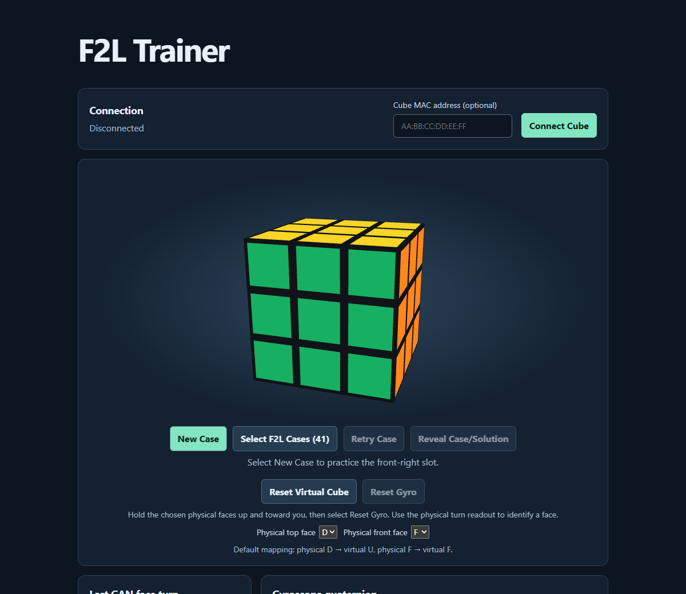

# F2L Trainer

Setting up F2L cases by hand slows down practice. When you repeat the same setups, you start to recognize the setup sequence before you’ve had a chance to read the case. And choosing an algorithm on a screen skips the physical turns that build muscle memory.

This trainer generates the F2L case on screen and uses a GAN i4 as the controller. Look at the virtual cube to recognize the case, then execute the solution by turning the cube in your hands. The virtual cube responds in real time and tells you when the pair is solved. The physical cube can start in any state, so you can go straight into the next case.



Open the [hosted F2L Trainer](https://gbisaga.github.io/f2l-trainer/) in desktop Chrome or Edge to connect your GAN i4.

## Run locally

Use Node.js 22.12 or newer. Dependencies are already installed in this workspace. For a fresh checkout, run `npm ci` first.

```sh
npm run dev
```

Open the localhost URL printed by Vite in desktop Chrome or Edge. Turn on Bluetooth, wake the GAN i4 with a face turn, and disconnect it from any other cube app. Click **Connect Cube** and select it in the browser picker.

If the connection reports that it cannot determine or verify the cube MAC address, enter the cube's Bluetooth MAC in the optional field and try again. Use six colon-separated hex pairs, such as `AA:BB:CC:DD:EE:FF`.

On Windows, open `chrome://bluetooth-internals/#devices` in Chrome or
`edge://bluetooth-internals/#devices` in Edge. Start a scan, wake the cube,
and copy the **Address** for **Gan i4**. Stop the scan, paste the address into
the trainer, and reconnect. The library remembers a verified address for that
device on the same browser and site origin.

## Practice F2L

1. Connect the GAN i4, then open **Select F2L Cases** to choose any subset of the 41 cases, grouped by SpeedCubeDB category. All cases are enabled on first use and selections are saved in the browser.
2. Select **New Case**. The trainer picks from the pool, avoids repeating the previous case when possible, and randomizes the U-layer alignment. The target stays front-right.
3. Solve the target pair with physical face turns. The trainer checks the target corner and edge, the cross, and the other three slots. The last layer may remain scrambled. Recognition, execution, and total times appear when the attempt is solved.
4. Select **Retry Case** to restore the exact starting sticker state and restart timing. **Reveal Case/Solution** shows the number and an algorithm for that starting state, including the alignment move if needed.
5. **Reset Gyro** adjusts the view during practice. **Reset Virtual Cube** leaves the exercise and returns to free turning on a solved cube.

The [SpeedCubeDB F2L library](https://www.speedcubedb.com/a/3x3/F2L) defines the case numbering and source setups. Virtual U is yellow, D is white (the cross), and F is green. Reference algorithms use virtual face labels. Cases 8 and 13 use outer-turn setups with matching target-piece configurations. Timings use the first rendered frame and the browser's receipt of face-turn events.

## Face calibration

The default mapping treats GAN face D as virtual U and GAN face F as virtual F. Hold the cube with those physical faces up and forward on first connection. For another grip, choose the two adjacent GAN face identifiers in the calibration controls, hold them up and forward, then select **Reset Gyro**. The last physical turn readout identifies the GAN face if needed.

Calibration maps all six physical face identifiers to virtual faces. Whole-cube motion changes where those faces appear on screen. For example, after mapping physical D to virtual U, a physical D turn still turns virtual U when that face is viewed from the side. Reset Gyro preserves the scramble and timers. Reset Virtual Cube preserves the mapping and view. The Bluetooth adapter keeps facelet events as log markers and discards the sticker payload.

## Test with a GAN i4

1. Hold GAN face D up and F forward. Connect and check that the virtual cube starts solved with yellow up and green front, even if the physical puzzle is scrambled. The first valid gyro sample becomes the reference.
2. Turn physical L clockwise. With the default mapping, check that virtual R turns immediately. Reset the virtual cube, perform physical `L D L' D'`, and check that the virtual result follows `R U R' U'`.
3. Rotate the whole cube about each axis. Check that the view follows in the same direction and the move count stays fixed.
4. Rotate the cube 90 degrees, then turn physical L again. Virtual R should turn in its new screen position and the physical event log should still report `L`.
5. With the virtual puzzle scrambled, select physical R for the top and F for the front. Hold them up and forward and select **Reset Gyro**. The virtual cube returns to the yellow-up, green-front view with its scramble intact. A physical R turn should now apply virtual U.
6. Rotate away from the home view and select **Reset Virtual Cube**. The puzzle becomes solved in its current viewing orientation. Make another face turn and confirm it applies from solved.
7. Repeat a quick sequence slowly after resetting. Compare the turn count and final virtual state. The log shows the latest 20 events, including gyro readings.
8. Disconnect and reconnect. The virtual puzzle persists, and the first gyro sample sets a fresh orientation reference.

GAN move labels are fixed to the physical centers. The [GAN sample](https://github.com/afedotov/gan-cube-sample/blob/main/src/index.ts) supplies the gyro axis convention. Check the direction of all three axes on the i4. The renderer requires WebGL 2.

Run `npm run build` to type-check and build the app.

Run `npm test` to check the 41 F2L cases at all four U alignments, retry timing, and face mapping for all 24 grip calibrations.
